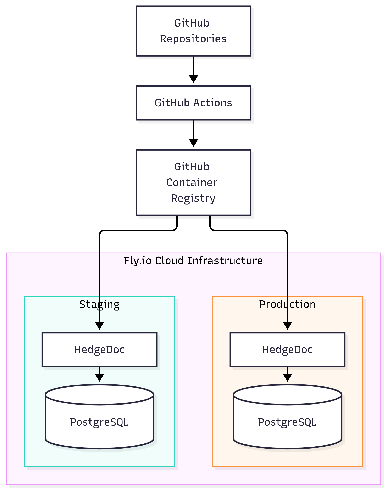

# Project Concept: Automated Deployment and Operation of HedgeDoc

## 1. Introduction and Motivation

The goal of this project is to implement an automated software delivery lifecycle for [HedgeDoc](https://github.com/hedgedoc/hedgedoc), an open-source, web-based collaborative Markdown editor.

HedgeDoc allows multiple users to create, edit, and share Markdown documents in real time. It is a suitable application for this project because it consists of several components, including a web application, a database, and persistent file storage. These components provide a realistic scenario for demonstrating infrastructure provisioning, configuration management, containerization, continuous integration, and continuous deployment.

Since I don't have mach experience with similar applications and technologies, I decided to select HedgeDoc from the recommended application options provided for the project. I chose the first recommended option to avoid spending too much time evaluating different applications and instead focus on the practical implementation of the project.

The main objective is to establish a reproducible and automated infrastructure in which HedgeDoc can be developed, tested, deployed, and operated with as little manual intervention as reasonably possible.

The project will focus not only on running the application but also on implementing an automated software lifecycle, from changes in the source code to the deployment of a new application version.

## 2. Architecture and Infrastructure

### 2.1 Hosting Environment

The application will be hosted on Fly.io, a cloud platform that provides application hosting and deployment capabilities. Fly.io allows applications to be deployed as lightweight virtual machines, with support for containerized workloads.

The infrastructure will use Fly.io to host two logically separated environments:

- **Staging:** Used to deploy and test new application versions before they reach production.
- **Production:** Hosts the stable version of HedgeDoc and represents the environment intended for regular use.

Both environments will run as separate deployments on Fly.io. They will have separate application containers, PostgreSQL databases, persistent volumes, and Docker networks.

A local development environment will additionally be available using Docker Compose. This allows developers to work on the application without requiring access to the cloud infrastructure.

Using Fly.io provides a relatively simple way to manage application deployments and separate staging and production environments without having to manually provision and maintain a traditional virtual machine. It also allows the project to focus on automating the software delivery lifecycle, including building, testing, and deploying new application versions.

### 2.2 Infrastructure Provisioning

The cloud infrastructure will be managed using the Fly.io CLI (flyctl).

The Fly.io CLI will be used to create, configure, and manage the required cloud resources, including:

Fly.io applications for the staging and production environments.

Application deployment and machine configuration.

Persistent storage volumes where required.

Network and service configuration.

Application secrets and environment variables.

The infrastructure and deployment configuration will be stored in a separate Git repository. Fly.io configuration files, such as fly.toml, will be version-controlled to ensure that deployment settings are reproducible and reviewable.

Infrastructure management and application deployment will be integrated into GitHub Actions where appropriate.

### 2.3 Application Architecture

HedgeDoc will run as a containerized application using Docker. Docker Compose will be used for the local development environment, while Fly.io will manage the application deployments in the cloud.

The virtual machine will host the following services:

- **HedgeDoc Staging:** An instance of the application used for testing new versions.
- **HedgeDoc Production:** The stable application instance.
- **PostgreSQL:** Separate database containers for staging and production.

Docker Compose will manage the containers, their dependencies, networks, and persistent volumes.

The two environments will use separate databases, uploads directories, and Docker networks to prevent unintended interference between them.

Database access will be restricted to the internal Fly.io private network wherever possible. Only the application services will be exposed through their respective public endpoints.

The application will be configured through environment variables. Sensitive configuration values, such as database credentials and application secrets, will be stored securely using Fly.io secrets and will not be committed to the Git repositories.

### 2.4 Architecture Diagram

The planned infrastructure can be represented as follows:



The architecture diagram was generated using [Mermaid](https://mermaid.ai), a text-based diagramming tool that allows diagrams to be created and maintained using code.

Fly.io CLI (flyctl) is used to manage the cloud infrastructure and application configuration, while Fly.io handles the underlying application hosting and networking. GitHub Actions automates the application build, testing, and deployment process.

## 3. Software Lifecycle and Automation

The software lifecycle will be automated using GitHub Actions. The pipeline will connect the application repository with the container registry and the cloud environment.

The lifecycle consists of the following stages:

### 3.1 Development and Version Control

The original HedgeDoc repository will be forked into a personal GitHub repository.

Development and configuration changes will be tracked using Git. The upstream HedgeDoc repository will be monitored, and upstream changes will regularly be integrated into the fork using Git rebase.

The infrastructure code will be maintained in a separate repository.

This separation keeps application development independent from infrastructure management.

### 3.2 Continuous Integration

GitHub Actions will automatically execute a CI pipeline when changes are pushed or pull requests are opened.

The pipeline will include the following steps:

1. Check out the application source code.
2. Install the required dependencies.
3. Execute the available automated tests.
4. Perform basic code and configuration checks.
5. Build the application Docker image.
6. Tag the image with the corresponding Git commit SHA.
7. Publish the image to GitHub Container Registry if the pipeline succeeds.

The pipeline ensures that changes are checked before they are deployed to an environment.

### 3.3 Application Deployment Process

After a successful CI pipeline, the application will be deployed to the cloud infrastructure.

The deployment process will consist of the following steps:

1. **Staging deployment:** GitHub Actions authenticates with Fly.io and deploys the newly built application image to the staging application.
2. **Health checks:** After deployment, automated checks verify that the HedgeDoc instance starts successfully and responds to HTTP requests.
3. **Staging verification:** The staging environment can be accessed to test the application before releasing the new version.
4. **Production approval:** A manual approval step in GitHub Actions is required before deploying the new version to production.
5. **Production deployment:** The same Docker image that was successfully deployed to staging is deployed to production.
6. **Post-deployment verification:** Health checks are executed again to ensure that the production application is running correctly.

Using the same immutable image for both environments ensures that the tested version is also the version released to production.

If a deployment causes problems, the previous application image can be redeployed. Database backups provide an additional recovery mechanism.

### 3.4 Infrastructure Deployment

Infrastructure changes will be managed independently from application releases.

The Fly.io CLI (flyctl) will be used to create, configure, and manage the required Fly.io resources. Infrastructure changes will be made through CLI commands and configuration files, such as fly.toml.

The configuration files will be stored in the infrastructure Git repository to ensure that changes are version-controlled, reviewable, and reproducible.

Application-specific deployment configuration will also be maintained using Fly.io configuration files.

This approach makes it possible to recreate the infrastructure from version-controlled definitions instead of relying on manually configured servers.

### 3.5 Maintenance and Operation

The project will also address the operation of the deployed application.

The following aspects will be considered:

- **Persistent storage:** Database data and uploaded files will survive container restarts and application updates.
- **Backups:** Regular PostgreSQL backups will be created to allow data recovery.
- **HTTPS:** Fly.io will provide encrypted communication using automatically managed TLS certificates.
- **Health checks:** Application availability will be checked after deployment.
- **Logging:** Application and machine logs will be available through Fly.io for troubleshooting.
- **Updates:** Application dependencies and container images will be updated through controlled changes in the repositories.

The deployment process will use versioned container images so that previous versions can be redeployed if a new release causes problems.

## 4. Environments

The project will provide three environments with different purposes.

|Environment|Purpose|Deployment|
|-|-|-|
|Development|Local development and testing|Manual using Docker Compose|
|Staging|Testing new application versions|Automatic through GitHub Actions|
|Production|Running the stable application|Manual approval through GitHub Actions|

The development environment will run locally, while staging and production will run as separate applications on Fly.io.

Both cloud environments will use the same basic application architecture but different configuration values, credentials, and domain names.

Although staging and production will use the same Fly.io platform, their application instances, databases, and persistent storage will be separated.

This separation allows new versions to be tested without directly affecting the production application.

## 5. Technology Stack and Design Decisions

The following technologies have been selected for the implementation:

|Technology|Purpose|Reason for selection|
|-|-|-|
|Fly.io|Cloud infrastructure|Provides container-based application hosting and deployment capabilities.|
|Fly.io CLI (flyctl)|Infrastructure and deployment management|Official command-line tool for managing Fly.io applications and resources.|
|Docker|Containerization|Provides consistent application environments.|
|Docker Compose|Container management|Offers a straightforward way to manage the local development environment.|
|GitHub Actions|CI/CD|Integrates directly with GitHub and automates the software lifecycle.|
|GitHub Container Registry|Image registry|Stores versioned application images for deployment.|
|PostgreSQL|Database|Provides reliable persistent storage for HedgeDoc.|
|Git|Version control|Tracks application source code and infrastructure changes.|

Kubernetes will not be used because the planned infrastructure is relatively small and does not require a full container orchestration platform. Fly.io provides the functionality needed for deploying and managing the application with significantly less operational complexity.

Similarly, PostgreSQL will run as a separate service using persistent storage rather than relying on temporary container storage. This allows the database configuration and lifecycle to be managed independently from the application.

## 6. Repository Structure

The project will consist of two separate Git repositories.

**Repository 1: HedgeDoc application fork**

This repository will contain the fork of the original HedgeDoc application. It will be used for source code management, upstream synchronization, and the application CI pipeline.

**Repository 2: Infrastructure and deployment**

This repository will contain all files required to provision, configure, and operate the infrastructure.

The planned structure is:

```text
hedgedoc-infrastructure/
├── concept.md
├── README.md
├── fly/
│   ├── staging/
│   │   └── fly.toml
│   └── production/
│       └── fly.toml
├── docker/
│   └── development/
│       └── docker-compose.yml
└── .github/
    └── workflows/
        ├── infrastructure.yml
        └── deployment.yml
```

The exact structure may be adjusted during implementation.

## 7. Expected Results

At the end of the project, the following results are expected:

- A working HedgeDoc instance deployed on Fly.io.
- Separate staging and production environments.
- Infrastructure and application deployments managed using the Fly.io CLI.
- A containerized application deployed using Fly.io.
- A local development environment managed with Docker Compose.
- An automated CI pipeline for testing and building the application.
- An automated deployment pipeline for staging and production.
- HTTPS access through Fly.io's built-in networking services.
- Persistent database and upload storage.
- A basic backup and recovery mechanism.
- Documentation explaining the architecture, provisioning, deployment, and operation of the system.

The overall result will demonstrate how DevOps practices can be applied to an existing open-source application to create a reproducible, maintainable, and automated software delivery process.

## 8. References

- HedgeDoc source repository: https://github.com/hedgedoc/hedgedoc
- HedgeDoc documentation: https://docs.hedgedoc.org/
- HedgeDoc Docker deployment: https://docs.hedgedoc.org/setup/docker/
- HedgeDoc production deployment recommendations: https://docs.hedgedoc.org/guides/production-ready/
- HedgeDoc configuration documentation: https://docs.hedgedoc.org/configuration/
- Fly.io documentation: https://fly.io/docs/
- Fly.io application deployment: https://fly.io/docs/launch/
- Fly.io configuration reference: https://fly.io/docs/reference/configuration/
- Fly.io persistent storage: https://fly.io/docs/volumes/
- Fly.io private networking: https://fly.io/docs/networking/private-networking/
- Fly.io secrets: https://fly.io/docs/apps/secrets/
- Fly.io CLI: https://fly.io/docs/flyctl/
- Docker Compose documentation: https://docs.docker.com/compose/
- GitHub Actions documentation: https://docs.github.com/en/actions
- GitHub Container Registry documentation: https://docs.github.com/en/packages/working-with-a-github-packages-registry/working-with-the-container-registry

\---

**Source and assistance indication:** This concept was prepared with assistance from ChatGPT (OpenAI). The author is responsible for reviewing the proposed architecture, verifying the technical details, and making the final project decisions. Additional AI assistance and external sources used during implementation will be indicated according to the course requirements.

