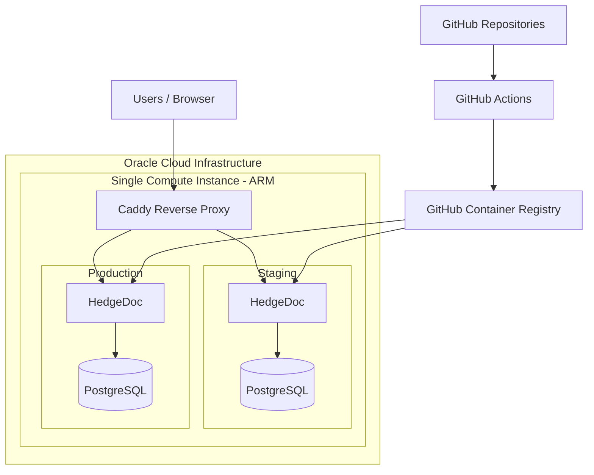

# Project Concept: Automated Deployment and Operation of HedgeDoc

## 1. Introduction and Motivation

The goal of this project is to implement an automated software delivery lifecycle for [HedgeDoc](https://github.com/hedgedoc/hedgedoc), an open-source, web-based collaborative Markdown editor.

HedgeDoc allows multiple users to create, edit, and share Markdown documents in real time. It is a suitable application for this project because it consists of several components, including a web application, a database, and persistent file storage. These components provide a realistic scenario for demonstrating infrastructure provisioning, configuration management, containerization, continuous integration, and continuous deployment.

The main objective is to establish a reproducible and automated infrastructure in which HedgeDoc can be developed, tested, deployed, and operated with as little manual intervention as reasonably possible.

The project will focus not only on running the application but also on implementing an automated software lifecycle, from changes in the source code to the deployment of a new application version.

## 2. Architecture and Infrastructure

### 2.1 Hosting Environment

The application will be hosted on **Oracle Cloud Infrastructure (OCI)**, using its Always Free resources to minimize infrastructure costs.

OCI provides free compute resources, storage, and networking capabilities that are sufficient for hosting a small application. In particular, the Ampere A1 ARM-based compute instances offer up to 2 OCPUs and 12 GB of memory within the Always Free allowance.

The infrastructure will consist of one virtual machine hosting two logically separated environments:

- **Staging:** Used to deploy and test new application versions before they reach production.
- **Production:** Hosts the stable version of HedgeDoc and represents the environment intended for regular use.

Both environments will run as separate Docker Compose stacks on the same virtual machine. They will have separate application containers, PostgreSQL databases, persistent volumes, and Docker networks.

A local development environment will additionally be available using Docker Compose. This allows developers to work on the application without requiring access to the cloud infrastructure.

Using one virtual machine keeps the infrastructure within the intended free-tier budget while still allowing the implementation of a deployment workflow with separate staging and production environments.

### 2.2 Infrastructure Provisioning

The cloud infrastructure will be provisioned using **Terraform**.

Terraform will define and manage the required infrastructure resources, including:

- An OCI compute instance.
- A Virtual Cloud Network (VCN) and subnet.
- Security lists or network security groups to restrict incoming network traffic.
- Required storage resources and networking configuration.

The infrastructure definition will be stored in a separate Git repository. This ensures that infrastructure changes are version-controlled, reviewable, and reproducible.

The configuration of the provisioned server will be automated using **Ansible**. Ansible will be responsible for preparing the virtual machine, installing Docker and Docker Compose, configuring the required directories, and deploying the application stack.

This separation allows Terraform to manage infrastructure resources while Ansible handles the configuration of the operating system and services running on it.

### 2.3 Application Architecture

HedgeDoc will run as a containerized application using Docker and Docker Compose.

The virtual machine will host the following services:

- **HedgeDoc Staging:** An instance of the application used for testing new versions.
- **HedgeDoc Production:** The stable application instance.
- **PostgreSQL:** Separate database containers for staging and production.
- **Caddy:** A reverse proxy that forwards incoming requests to the appropriate HedgeDoc instance and automatically manages HTTPS certificates.

Docker Compose will manage the containers, their dependencies, networks, and persistent volumes.

The two environments will use separate databases, uploads directories, and Docker networks to prevent unintended interference between them.

The PostgreSQL databases and uploaded files will use persistent storage so that application restarts or container replacements do not result in data loss.

Only the reverse proxy will be directly accessible from the internet. Database access will be restricted to the internal Docker networks.

The application will be configured through environment variables. Sensitive configuration values, such as database credentials, will be stored securely and will not be committed to the Git repositories.

### 2.4 Architecture Diagram

The planned infrastructure can be represented as follows:



Terraform provisions the OCI infrastructure, while Ansible configures the virtual machine and its services. GitHub Actions handles the application build and deployment process.

## 3. Software Lifecycle and Automation

The software lifecycle will be automated using GitHub Actions. The pipeline will connect the application repository with the container registry and the cloud environment.

The lifecycle consists of the following stages:

### 3.1 Development and Version Control

The original HedgeDoc repository will be forked into a personal GitHub repository.

Development and configuration changes will be tracked using Git. The upstream HedgeDoc repository will be monitored, and upstream changes will regularly be integrated into the fork using Git rebase.

The infrastructure code will be maintained in a separate repository.

This separation keeps application development independent from infrastructure management.

### 3.2 Continuous Integration

GitHub Actions will automatically execute a CI pipeline when changes are pushed or pull requests are opened.

The pipeline will include the following steps:

1. Check out the application source code.
2. Install the required dependencies.
3. Execute the available automated tests.
4. Perform basic code and configuration checks.
5. Build the application Docker image.
6. Tag the image with the corresponding Git commit SHA.
7. Publish the image to GitHub Container Registry if the pipeline succeeds.

The pipeline ensures that changes are checked before they are deployed to an environment.

### 3.3 Application Deployment Process

After a successful CI pipeline, the application will be deployed to the cloud infrastructure.

The deployment process will consist of the following steps:

1. **Staging deployment:** GitHub Actions connects to the OCI virtual machine via SSH and updates the staging Docker Compose stack to use the newly built application image.

2. **Health checks:** After deployment, automated checks verify that the HedgeDoc instance starts successfully and responds to HTTP requests.

3. **Staging verification:** The staging environment can be accessed to test the application before releasing the new version.

4. **Production approval:** A manual approval step in GitHub Actions is required before deploying the new version to production.

5. **Production deployment:** The same Docker image that was successfully deployed to staging is deployed to production. The application is updated using Docker Compose.

6. **Post-deployment verification:** Health checks are executed again to ensure that the production application is running correctly.

Using the same immutable image for both environments ensures that the tested version is also the version released to production.

If a deployment causes problems, the previous application image can be redeployed. Database backups provide an additional recovery mechanism.

### 3.4 Infrastructure Deployment

Infrastructure changes will be managed independently from application releases.

When infrastructure code changes, Terraform will generate an execution plan showing the required modifications. After reviewing the plan, the changes can be applied to OCI.

Following provisioning, Ansible will configure the server and ensure that the required services are installed and running.

This approach makes it possible to recreate the infrastructure from version-controlled definitions instead of relying on manually configured servers.

### 3.5 Maintenance and Operation

The project will also address the operation of the deployed application.

The following aspects will be considered:

- **Persistent storage:** Database data and uploaded files will survive container restarts and application updates.
- **Backups:** Regular PostgreSQL backups will be created to allow data recovery.
- **HTTPS:** Caddy will provide encrypted communication using automatically managed TLS certificates.
- **Health checks:** Application availability will be checked after deployment.
- **Logging:** Container logs will be available through Docker for troubleshooting.
- **Updates:** Application dependencies and container images will be updated through controlled changes in the repositories.

The deployment process will use versioned container images so that previous versions can be redeployed if a new release causes problems.

## 4. Environments

The project will provide three environments with different purposes.

| Environment | Purpose | Deployment |
|---|---|---|
| Development | Local development and testing | Manual using Docker Compose |
| Staging | Testing new application versions | Automatic through GitHub Actions |
| Production | Running the stable application | Manual approval through GitHub Actions |

The development environment will run locally, while staging and production will run as separate Docker Compose stacks on the same OCI virtual machine.

Both cloud environments will use the same basic application architecture but different configuration values, credentials, and domain names.

Although staging and production share the underlying virtual machine, their application containers, databases, and persistent storage will be separated.

This separation allows new versions to be tested without directly affecting the production application.

## 5. Technology Stack and Design Decisions

The following technologies have been selected for the implementation:

| Technology | Purpose | Reason for selection |
|---|---|---|
| Oracle Cloud Infrastructure | Cloud infrastructure | Provides Always Free compute resources suitable for a small application. |
| Terraform | Infrastructure as Code | Allows infrastructure to be defined, version-controlled, and reproduced. |
| Ansible | Configuration management | Automates server configuration without requiring an additional agent. |
| Docker | Containerization | Provides consistent application environments. |
| Docker Compose | Container management | Offers a straightforward way to manage multiple application services and environments. |
| GitHub Actions | CI/CD | Integrates directly with GitHub and automates the software lifecycle. |
| GitHub Container Registry | Image registry | Stores versioned application images for deployment. |
| PostgreSQL | Database | Provides reliable persistent storage for HedgeDoc. |
| Caddy | Reverse proxy | Handles HTTPS certificates and forwards requests to the application. |
| Git | Version control | Tracks application source code and infrastructure changes. |

Kubernetes will not be used because the planned infrastructure is relatively small and does not require a full container orchestration platform. Docker Compose provides the functionality needed for this project with significantly less operational complexity.

Similarly, PostgreSQL will run as a container rather than using a separately managed database service. This keeps the infrastructure reproducible and allows the database configuration to be managed together with the application stack.

The use of an ARM-based OCI compute instance is also suitable because the official HedgeDoc Docker images support both AMD64 and ARM64 architectures.

## 6. Repository Structure

The project will consist of two separate Git repositories.

**Repository 1: HedgeDoc application fork**

This repository will contain the fork of the original HedgeDoc application. It will be used for source code management, upstream synchronization, and the application CI pipeline.

**Repository 2: Infrastructure and deployment**

This repository will contain all files required to provision, configure, and operate the infrastructure.

The planned structure is:

```text
hedgedoc-infrastructure/
├── concept.md
├── README.md
├── terraform/
│   ├── main.tf
│   ├── variables.tf
│   ├── outputs.tf
│   └── providers.tf
├── ansible/
│   ├── inventory/
│   ├── playbooks/
│   └── roles/
├── docker/
│   ├── staging/
│   │   ├── docker-compose.yml
│   │   └── .env.example
│   ├── production/
│   │   ├── docker-compose.yml
│   │   └── .env.example
│   └── Caddyfile
└── .github/
    └── workflows/
        ├── infrastructure.yml
        └── deployment.yml
```

The exact structure may be adjusted during implementation.

## 7. Expected Results

At the end of the project, the following results are expected:

- A working HedgeDoc instance deployed in Oracle Cloud.
- Separate staging and production environments.
- Infrastructure that can be provisioned automatically using Terraform.
- Server configuration automated using Ansible.
- A containerized application stack managed with Docker Compose.
- An automated CI pipeline for testing and building the application.
- An automated deployment pipeline for staging and production.
- HTTPS access through a reverse proxy.
- Persistent database and upload storage.
- A basic backup and recovery mechanism.
- Documentation explaining the architecture, provisioning, deployment, and operation of the system.

The overall result will demonstrate how DevOps practices can be applied to an existing open-source application to create a reproducible, maintainable, and automated software delivery process.

## 8. References

- HedgeDoc source repository: https://github.com/hedgedoc/hedgedoc
- HedgeDoc documentation: https://docs.hedgedoc.org/
- HedgeDoc Docker deployment: https://docs.hedgedoc.org/setup/docker/
- HedgeDoc production deployment recommendations: https://docs.hedgedoc.org/guides/production-ready/
- HedgeDoc configuration documentation: https://docs.hedgedoc.org/configuration/
- Oracle Cloud Free Tier: https://www.oracle.com/cloud/free/
- Oracle Cloud Always Free resources: https://docs.oracle.com/en-us/iaas/Content/FreeTier/freetier_topic-Always_Free_Resources.htm
- Terraform OCI provider: https://github.com/oracle/terraform-provider-oci
- Terraform documentation: https://developer.hashicorp.com/terraform/docs
- Ansible documentation: https://docs.ansible.com/
- Docker Compose documentation: https://docs.docker.com/compose/
- GitHub Actions documentation: https://docs.github.com/en/actions

---

**Source and assistance indication:** This concept was prepared with assistance from ChatGPT (OpenAI). The author is responsible for reviewing the proposed architecture, verifying the technical details, and making the final project decisions. Additional AI assistance and external sources used during implementation will be indicated according to the course requirements.